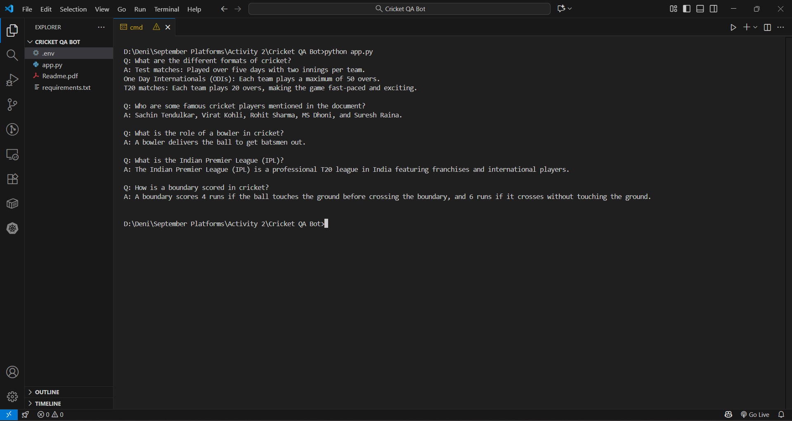

# Cricket QA Bot

**A small LangChain demo that answers cricket questions strictly from a fixed context block, so the model stays grounded instead of making things up.**

  

## Overview

Cricket QA Bot is a context-grounded question-answering script. It takes a short, hand-written document of cricket facts and answers questions from that text only, not from the model's training and not from the web. The point of the project is the grounding technique: a LangChain chain feeds a fixed context and a question to Google's Gemini model, and the prompt tells it to answer from the context.

I built it as a learning exercise to get comfortable with LangChain Expression Language (LCEL) and prompt-based grounding. It's deliberately small: one `app.py`, a knowledge base defined inline, and five demo questions that run on startup so you can see the chain work end to end. It shows how few moving parts you need to get an LLM answering from a source you control.

## Key Features

- **Context-grounded answers.** Every response is generated from a single cricket document, passed into the prompt on each call. The model is told to answer using only that context.
- **Grounding through the prompt.** A system instruction ("Answer the question using only the provided context") is meant to keep Gemini from inventing facts that aren't in the knowledge base. Nothing checks that it complies.
- **Consistent output.** The model runs at `temperature=0`, so the same question gets the same focused answer, which suits a factual lookup.
- **LCEL chain composition.** The pipeline is one LangChain chain: format the context, slot in the question, apply the prompt template, call the model, parse out the string.
- **Self-contained knowledge base.** The cricket facts (game basics, match formats, player roles, tournaments, scoring rules) are written into the script and wrapped as a LangChain `Document`.
- **Runnable demo.** Five predefined questions run on launch and print `Q:` / `A:` pairs to the console.
- **Environment-based key handling.** The Gemini API key is read from a `.env` file with `python-dotenv`, so no secrets are hardcoded.

## How It Works

The script wires a few pieces together with LCEL and runs a list of questions through them.

### 1. The knowledge base

The context is a multi-line string defined in `app.py`. It covers:

- **Game basics**: two teams of eleven, the 22-yard pitch, batting vs. bowling/fielding.
- **Match formats**: Test (five days, two innings), ODI (50 overs), T20 (20 overs).
- **Player roles**: batsman, bowler, all-rounder, wicketkeeper.
- **Tournaments**: ICC Cricket World Cup, ICC T20 World Cup, IPL, Big Bash League.
- **Scoring and rules**: running between wickets, 4s and 6s, a six-ball over, field placements and powerplays.

It also names a few famous players, with no stats. The string is wrapped in a `langchain_core.documents.Document`, the format LangChain expects when passing content into a chain.

### 2. The model

The LLM is `ChatGoogleGenerativeAI` pointing at `models/gemini-2.0-flash`, with `temperature=0`. Zero temperature is deliberate: the task is factual lookup from a fixed source, so I want consistent answers, not creative ones. The API key comes from the `GEMINI_API_KEY` environment variable.

### 3. The grounding prompt

A `ChatPromptTemplate` defines two messages:

- a **system** message that injects the context and tells the assistant to answer using only that context;
- a **human** message that carries the user's question.

This prompt is where the grounding happens. The model is constrained by instruction, not by any retrieval step.

### 4. The chain

The pipeline is a single LCEL composition:

```python
stuff_chain = (
    {
        "context": lambda x: format_docs(x["context"]),
        "input": lambda x: x["input"]
    } | qa_prompt | model | StrOutputParser()
)
```

Reading left to right: a small mapping prepares the inputs. `format_docs` joins the document's `page_content` into a plain string for `{context}`, and the question goes straight through to `{input}`. That feeds the `ChatPromptTemplate`, which builds the final prompt. The prompt goes to Gemini, and `StrOutputParser` turns the model's message into a plain string. It's the classic "stuff" pattern: the whole context goes into one prompt, which works because the knowledge base is short. There is no retrieval step.

### 5. Running the questions

At the bottom, the script loops over five demo questions, invokes the chain with the cricket `Document` as context each time, and prints each question and answer:

```python
questions = [
    "What are the different formats of cricket?",
    "Who are some famous cricket players mentioned in the document?",
    "What is the role of a bowler in cricket?",
    "What is the Indian Premier League (IPL)?",
    "How is a boundary scored in cricket?"
]
```

Sample run:



## Tech Stack

- **Language:** Python 3
- **Frameworks / libraries:** LangChain (`langchain`, `langchain-core`), `langchain-google-genai`
- **AI model:** Google Gemini (`gemini-2.0-flash`)
- **Utilities:** `python-dotenv` for environment variable loading

## Getting Started

### Prerequisites

- Python 3.x
- A Google Gemini API key ([Google AI Studio](https://aistudio.google.com/app/apikey))

### Installation

```bash
git clone https://github.com/DCode-v05/Cricket-QA-Bot.git
cd Cricket-QA-Bot
pip install -r requirements.txt
```

`requirements.txt` doesn't pin versions.

### Set up your API key

Create a `.env` file in the project root:

```env
GEMINI_API_KEY=your_api_key_here
```

### Running

```bash
python app.py
```

The script runs the five demo questions and prints the answers.

## Usage

By default the bot answers a fixed list of questions to show the chain working. To ask your own, edit the `questions` list in `app.py`:

```python
questions = [
    "How long is a Test match?",
    "What is a powerplay?",
]
```

The prompt asks the model to use only the inline document, but nothing enforces it. To extend what the bot knows, expand the `cricket_document_data` string. The chain picks up the new context automatically, with no other changes.

## Project Structure

```
Cricket-QA-Bot/
├── app.py              # Knowledge base, prompt, LCEL chain, and demo question loop
├── requirements.txt    # Python dependencies (langchain, langchain-google-genai, langchain-core, python-dotenv)
├── Output/
│   └── Output.png      # Screenshot of a sample run
└── README.md           # This file
```

---

## Contact

<table>
  <tr><td><b>Portfolio:</b> <a href="https://www.denistan.me">Denistan</a></td><td><b>LinkedIn:</b> <a href="https://www.linkedin.com/in/denistanb">denistanb</a></td></tr>
  <tr><td><b>GitHub:</b> <a href="https://github.com/DCode-v05">DCode-v05</a></td><td><b>LeetCode:</b> <a href="https://leetcode.com/u/Denistan_B">Denistan_B</a></td></tr>
  <tr><td colspan="2" align="center"><b>Email:</b> <a href="mailto:denistanb05@gmail.com">denistanb05@gmail.com</a></td></tr>
</table>

Made with ❤️ by **Denistan B**
